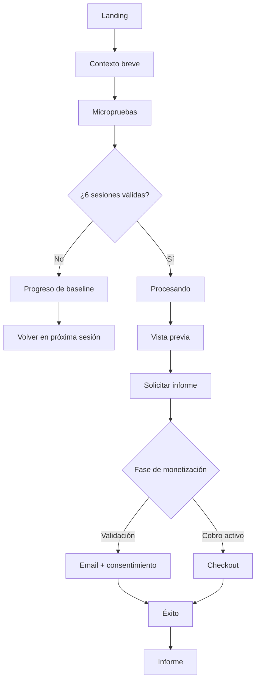
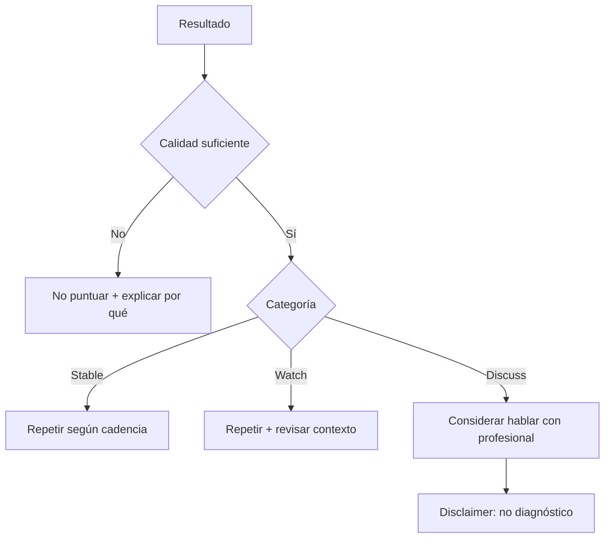

# Sitemap, rutas y flujos · CogniSignal

## Sitemap
- `/` Landing
- `/evaluacion/edad`
- `/evaluacion/pais`
- `/evaluacion/contexto`
- `/evaluacion/prueba/:task`
- `/procesando`
- `/resultado`
- `/informe/solicitar`
- `/checkout` (Fase 2)
- `/informe/listo`
- `/informe/:report_id`
- `/como-funciona`
- `/faq`
- `/legal/privacidad`
- `/legal/terminos`
- `/legal/aviso-medico`
- `/admin`
- SEO país: `/us/cognitive-change-tracker`, `/uk/cognitive-change-tracker`, `/es/seguimiento-cognitivo`, `/br/acompanhamento-cognitivo`, `/mx/seguimiento-cognitivo`
- SEO casos de uso: `/uso/memory-change-tracking`, `/uso/attention-change-tracking`, `/uso/personal-cognitive-baseline`

## Flujo principal

## Flujo de seguridad

## Reglas SEO
Las páginas SEO nunca deben prometer diagnóstico, prevención ni detección de Alzheimer. Canonical por locale, `hreflang` ES/EN/PT, contenido local real y precios solo cuando Fase 2 esté activa.
